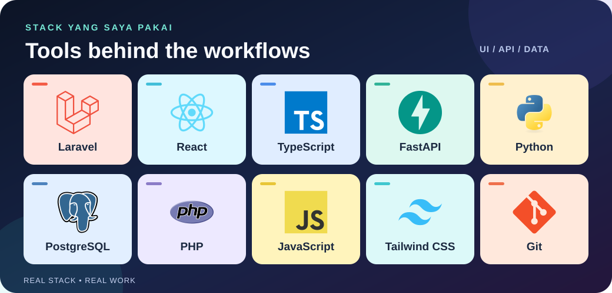

<h1 align="center">Halo, saya Maulana Muhammad Ikhsan 👋</h1>

  <strong>Finance Automation &amp; Full-Stack Developer</strong> 
  ERP integration · Bank &amp; sales reconciliation · Workflow automation

  <a href="https://www.linkedin.com/in/maulanamuhammadikhsan/">LinkedIn</a> ·
  <a href="https://myportfolio-phi-nine-86.vercel.app">Portofolio</a> ·
  <a href="https://github.com/maulanaikhsan55?tab=repositories">Repositori</a>

  

## 👋 Tentang saya

Latar belakang saya adalah Sistem Informasi Akuntansi di Telkom University. Saya bekerja di pertemuan antara proses finance, pengembangan aplikasi, dan integrasi sistem: membuat pekerjaan operasional lebih mudah dijalankan, diperiksa, dan ditelusuri.

Saya membangun serta mengembangkan alur procurement, invoice, reimbursement, dan rekonsiliasi. Pekerjaan saya mencakup integrasi Accurate Online, pemrosesan laporan penjualan, dan parser mutasi bank untuk menghasilkan data yang siap divalidasi. Lebih lengkap tentang pengalaman saya ada di [LinkedIn](https://www.linkedin.com/in/maulanamuhammadikhsan/).

## 🔎 Yang saya kerjakan

- **ERP &amp; finance workflows** — purchase order, invoice, stock, dan reimbursement yang terhubung dengan proses Accurate Online.
- **Rekonsiliasi bank &amp; penjualan** — membaca laporan dan rekening koran, menormalkan data, lalu membantu validasi serta pencocokan transaksi.
- **Otomasi &amp; keandalan** — API antarsistem, alur n8n, pengujian, debugging, dan dokumentasi agar hasil bisa diperiksa kembali.

## 🧰 Bahasa dan alat yang saya pakai

  

Antarmuka · Backend &amp; API · Data · Otomasi. Logo teknologi dari <a href="https://github.com/devicons/devicon">Devicon</a>.

## 💼 Pekerjaan pilihan

- **[Tomoro Bridging Internal](https://myportfolio-phi-nine-86.vercel.app/project-details/tomoro-bridging)** — menghubungkan procurement, invoice, stok, dan rekonsiliasi dengan Accurate Online.
- **[Zeirec](https://myportfolio-phi-nine-86.vercel.app/project-details/zeirec)** — workspace finance untuk reimbursement, rekonsiliasi, dan integrasi antarsistem.
- **[API Bank Reconcile](https://myportfolio-phi-nine-86.vercel.app/project-details/api-bank-reconcile)** — parser mutasi bank menjadi data terstruktur untuk sistem rekonsiliasi.
- **[DuckCost](https://myportfolio-phi-nine-86.vercel.app/project-details/duckcost)** — aplikasi perhitungan biaya produksi untuk UMKM.

## 📬 Terhubung

Lihat pengalaman saya di [LinkedIn](https://www.linkedin.com/in/maulanamuhammadikhsan/) atau eksplorasi karya lain di [portofolio](https://myportfolio-phi-nine-86.vercel.app).